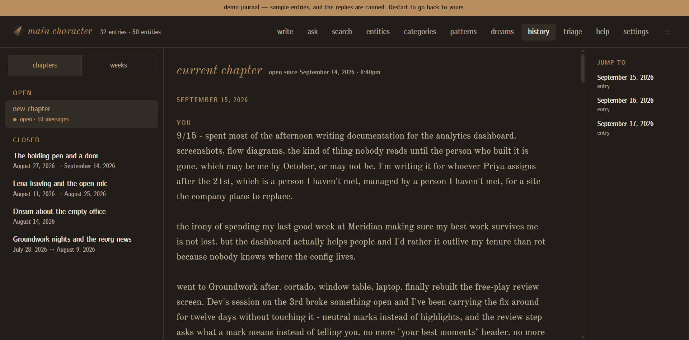

# Main Character

[](https://www.gnu.org/licenses/agpl-3.0)

**Find meaning in the story of your life.**

Main Character is a journal that organizes your life as you write it. Each entry is sorted into the people, places, projects and patterns it touches, and over time that becomes a record of your life you can search, revisit and make sense of:

- **Entry summaries.** Two or three sentences per entry: what happened, how you felt, what you decided. Skim a month in a minute.
- **Weekly arcs.** Each week retold as a short narrative of what happened, what changed and what carried over.
- **People, places and things.** A profile for each, with dated observations from your entries.
- **Categories and domain documents.** Entries tagged by life domain, like work, health or relationships, and one living page per domain that is rewritten as new entries arrive.
- **Patterns.** What repeats, once there is enough writing: emotional cycles, habits that lead to one another, relationship dynamics.
- **Life summary.** Your story retold as a whole. Each closed chapter drafts an update that you edit before saving.
- **Dreams.** Kept in their own realm, with their cast, their tone and your own reading of them.

What you do with it is up to you. Read it in History, look someone up, search by meaning or by exact words, or export the lot. It is all files on your disk, readable without this app.

A Claude companion can reply to each entry with a short comment, drawing on that same record for support and reflection. It is optional: tick *no reply* to save an entry without one. [How it works](HOW-IT-WORKS.md) walks through what runs when you write, close a chapter or ask a question.



## Start here

Clone it, give it an API key, and start writing. The journal builds itself from your entries, starting with the first one.

If you have a Claude conversation export, you can import it as a starting corpus. See [Importing a Claude export](#importing-a-claude-export). Most people will not have one, and the journal works fine without it.

**Tested on Windows only.** The full setup has been run from a clean Windows 11 account: install, first entry, closing a chapter, and stopping. The macOS and Linux commands below should work, but nobody has run them yet. If something breaks there, please [open an issue](https://github.com/ktocdev/main-character/issues).

### 1. Install

```bash
git clone https://github.com/ktocdev/main-character.git
cd main-character
./journal install
```

On Windows, run these in PowerShell, where `./journal` runs `journal.cmd`. In Command Prompt, leave off the `./` and type `journal install`.

This creates `.venv`, installs from the lock file and copies `.env.example` to `.env`. It is safe to run again. The install is large and slow because it pulls in ChromaDB's full dependency tree, including onnxruntime and tokenizers, plus fastembed, so that embeddings run on your machine instead of over the network. Install from the lock file. `requirements.txt` lists the same dependencies unpinned, for reference only.

**Python 3.12, 3.13 or 3.14.** Python 3.15 is not supported yet: onnxruntime, which runs the local embedding models, has not published a build for it, so the install fails. Python is installed once, not once per copy of the journal. Each copy gets its own `.venv`, built from that one install, and install picks the newest supported Python it finds.

On Windows, install Python with:

```powershell
py install 3.14
```

If `py` is not recognized, install the *Python Install Manager* from the Microsoft Store or [python.org](https://www.python.org/downloads/) first. A newer Python you already have can stay. Install picks 3.14 over it.

On macOS or Linux, install `python3.14` from your package manager, or choose a 3.14 release under *Looking for a specific release?* on [python.org](https://www.python.org/downloads/).

If install says it cannot find a supported Python even though you have one, for example one installed with uv, create the venv yourself and run install again:

```powershell
uv venv --seed --python 3.14 .venv           # or: <path to python.exe> -m venv .venv
./journal install
```

If `.venv` was made with an unsupported Python, install says so. Delete the `.venv` folder and run it again. You do not need to activate the venv, whatever uv suggests. `journal` runs the Python inside `.venv` directly.

### 2. Run it

```bash
./journal start
```

The journal opens at **http://127.0.0.1:8144**. The first time, a setup screen asks for a key from the [Anthropic Console](https://console.anthropic.com/) and saves it to `.env` for you. Everything else in that file has a working default. Then write something in the box and press *save entry*.

You can still put the key in `.env` yourself before starting (uncomment `ANTHROPIC_API_KEY` and paste it), and change it later under Settings.

Stop it with `./journal stop`, from any terminal. After pulling a new version, run `./journal restart` so the running journal picks it up.

Use these instead of `Ctrl+C`. `Ctrl+C` stops the journal at once, even while a companion reply or the background work that follows an entry is still running, and that work is lost after you have already paid for it. `journal stop` and `journal restart` refuse until nothing is running, so you can try again a moment later without losing it. `journal stop` also stops a journal that kept running after its terminal was closed. If `journal start` says its port is already in use, that is usually the cause.

## Try it without a key

A demo journal ships with the repo: seven weeks of a fictional life, with the companion's replies pre-recorded. You can see how the app works before deciding whether to pay for it.

It opens mid-week, three days after the author last closed a chapter. You can read the week so far, then press **close chapter** to watch the memory pipeline run. Each trip into the demo starts from that same point, so anything you write there lasts only until you leave.

```bash
./journal start
```

Then open **Settings → load demo journal**, or choose the demo on the first-run screen if you have not added a key yet. The first visit builds the demo's search index, which takes about a minute, or two or three if the embedding models still have to download.

The demo costs nothing because embeddings are computed locally and the replies are real Claude output, captured once and committed to this repo. Nothing calls the API. In demo mode the Anthropic SDK is never constructed, and the test suite checks this.

The demo is a separate journal with its own data directories. Nothing you type there can reach your own entries, and a restart returns you to your own journal. A banner stays visible the whole time you are in the demo.

The same demo also builds as a static site that runs entirely in the browser, with no server behind it. `python scripts/build_web_demo.py` writes it to `dist/web-demo/`. The UI is the real one, and its API calls are answered from reads captured before and after the recorded close. The other tabs are read-only, and a reload starts it over.

## What it costs

- **Reading, searching and browsing are free.** Embeddings are computed on your machine by two small local models. Search by meaning, for the companion and in the search tab, uses snowflake-arctic-embed-s, over entries split into short passages so that every part of a long entry can be found; summaries and dreams use it too. The journal's own index of whole entries uses all-MiniLM-L6-v2. Search never calls an API.
- **Building the record costs money.** Closing a chapter triggers a background pass that tags what you wrote, extracts people, places and things, and updates the summaries. That pass is most of the cost. The companion's reply to an entry is one call more, and *no reply* skips it.
- **Two models, so you can trade down.** The companion is the voice you read, and it defaults to Opus 5.5. Background processing is mechanical, runs in bulk, and uses most of the tokens. It defaults to Sonnet. Both can be changed in Settings.
- **Two spend caps,** one per session and one per calendar month, checked before each call. They exist to catch runaway spending, not to set a budget, so the defaults sit above what a heavy month of ordinary writing would cost.
- **Set a limit in the Anthropic Console too.** Every figure this app shows is an estimate from a hand-maintained price table, and the caps are only as reliable as the code that enforces them. A [spend limit on your Anthropic account](https://console.anthropic.com/settings/limits) holds even if this app's accounting is wrong.

## Your writing is only saved locally 

Everything lives in files on your disk. These three commands also available under Settings → Data, and work without a key:

- `python export.py` writes the whole journal to a folder: every entry as markdown, one `entries.json` containing all of them, and everything the pipeline inferred. You do not need this app to read any of it.
- `python backup.py` writes the same export as a single dated zip. The zip lands next to the journal on the same disk, so copy it somewhere that will outlive the machine.
- `python rebuild_index.py` rebuilds the search index from the markdown, for free. The first time, it downloads the search model (about 130 MB, once per user account, to `~/.cache/main-character`). After that it works offline. For a journal of a few hundred entries it takes a few minutes. The export leaves the index out because the index can be rebuilt from what the export already contains.

Where it all sits:

| Directory | What |
|---|---|
| `journal_entries/` | Your entries and dreams, as markdown |
| `chroma_data/` | The search index. Derived and rebuildable |
| `entity_graph/` | Extracted people, projects and places, with profiles |
| `summaries/` | Entry summaries, weekly arcs, domain docs, the life summary (`seed_summary.md`) |
| `categories/`, `patterns/`, `dreams/`, `sessions/` | The rest of the pipeline's output |

All of these directories are gitignored. Nothing leaves your machine except the prompt text sent to the Anthropic API when you write.

## Single-user and local-only

**Main Character is for one person on one computer, with no login. This is deliberate.**

The server binds to `127.0.0.1` and refuses requests from anywhere else. There are no accounts, no login and no permission model, because there is exactly one user: you.

This will not change in a later version. The server keeps its open conversation, its loaded entity index and its Chroma handle in one process-global dict (`STATE` in [`server.py`](server.py)). A second person on the same instance would not get their own journal. They would get *yours*, mid-sentence. So:

- Do not expose the port to the internet.
- Do not put it behind a reverse proxy and share the URL.
- Do not run it for more than one person. A multi-user deployment is unsafe.

**On a computer you share, other people can read it.** `127.0.0.1` means *this computer*, not *this user*. While the journal is running, anyone signed in to another account on the same machine can open it in their browser and read and write in it, as you. They can also open the files directly if the folder you cloned into is readable by other accounts. On Windows, a folder made directly on `C:\`, such as `C:\apps`, is readable by every account. Your own user folder, the one named after your account, is not. If you share a computer, clone the journal inside your user folder, and stop it with `journal stop` when you are not using it.

If several people want to use it, each one runs their own copy, ideally on their own computer.

## What it does

<details>
<summary><b>The full feature list</b></summary>

### Entity graph
- **Extraction.** People, projects, places, things (bands, podcasts, games, shows, movies, books, recurring events, and kinds you add yourself) and animals, pulled from every entry.
- **Profiles.** A one to three paragraph doc per entity, regenerated as context accumulates.
- **Observations.** Timestamped and tagged, browseable per entity by date.
- **Groups.** Nestable hand-made groupings. A group can roll up so its members collapse out of the flat list, and its "what ties them together" note is read with new entries and passed to the companion with each member's profile.
- **Identity.** A piece of something bigger can be a *part* of it (`Coda / Tabs`) instead of merged in. Two people with one name can be split (`Dev · work`, `Dev · friend`), and new entries that don't say which wait in triage. People from a chapter of life that's over can be retired: the companion still knows them when you name them, but won't bring them up.
- **Triage.** A keyboard-driven review queue for extracted entities (keep, merge, correct, rename, alias, part of, retype, retire, delete, never track, skip) with 50 levels of undo.

### Summaries
- **Entry summaries.** Two or three sentences per entry, cached incrementally.
- **Weekly arcs.** A short narrative per week, stitched from entry summaries, and readable in History under *weeks*.
- **Domain summaries.** A roughly 500-word doc per category, updated over time.
- **Life summary.** A rolling summary you co-edit, which opens every chapter. Each close drafts an update for you to review. It never replaces yours on its own.

### Categories
- **Automatic tagging** against ten built-in categories. Each can be turned off.
- **Organic categories.** Place, project and thing entities clustered by embedding, named by Claude, and confirmed or dismissed by you.
- **Custom categories,** hand-seeded with trigger keywords.

### Patterns
Recurring emotional cycles, behavioural pipelines and relationship dynamics, each tracked with dated instances and a confidence level. Detection runs when you ask for it, from the weekly arcs and domain docs. Dismissed patterns resurface only with new evidence. The companion sees the pattern library on every turn, one line per pattern, and is told to bring one up only when the conversation genuinely echoes it.

### Dreams
- **Realm isolation.** Dreams live in their own vector collection, so a waking query can never surface one by accident. A long dream is split into passages, so it can be found by any part of it.
- **Extraction.** Dreams are found in your entries automatically when a chapter closes, with no flag needed, or across your whole history on request. The entry itself stays in waking memory.
- **Cast.** Dream people and places are spelled to match the waking entity graph.
- **Dream weather.** A one-line tone signal from recent dreams, included in the companion's context.
- **Interpretations.** Your own interpretations are recorded. The app does not invent any.

### Chapters, search and the companion
- **Semantic retrieval.** Context is assembled in layers: recent entries and the life summary first, then passages matched by meaning and by keyword from anywhere in an entry, matching summaries, entity docs, then the pattern library. A whole new entry is searched piece by piece, so its ending finds connections as well as its opening.
- **Chapters.** One chapter stays open for about a week. Entries, replies and follow-ups braid into it and survive restarts. Closing the chapter turns your side into journal entries, one per day you wrote, archives the braid, and runs the memory pipeline in the background. Once a chapter gets long, the write screen asks whether you're ready to close it.
- **Reflection.** The companion opens a conversation by connecting threads across your history instead of waiting to be asked.

</details>

## Importing a Claude export

Optional, and only useful if you already have one. `python bulk_import.py` reads a Claude conversation export, chunks it, embeds it, splits it into search passages and writes markdown backups, so the journal has a history to work with from day one. Your messages become entries. Claude's replies are never stored as journal memory.

## Stack

Python and FastAPI on the backend, ChromaDB for local vector storage, the Claude API for generation, and plain HTML and vanilla JavaScript on the frontend. There is no build step and there are no frontend dependencies. See [HOW-IT-WORKS.md](HOW-IT-WORKS.md) for how the pieces fit together.

## Contributing

There is no `CONTRIBUTING.md` and no PR template, because the project is not set up for outside contributions. If you have found a bug or want something changed, open an issue.

Read the license before building on this code. It is AGPL-3.0-or-later, and the network-use clause is the part people most often miss. See below.

## Security

See [SECURITY.md](SECURITY.md). In short: local-only with no auth is the design, so running it exposed to the internet is out of scope and not a reportable bug. Key handling, prompt injection, XSS in rendered entries and DNS rebinding are all in scope.

## License

[GNU Affero General Public License v3.0 or later](LICENSE) (AGPL-3.0-or-later).

The Affero clause is the reason for this choice. If you run a modified version of this app as a network service that other people use, you have to offer them its source. MIT or plain GPL would allow someone to build a hosted, multi-tenant journal on this code without that obligation. Given what this app holds, that matters more here than in most projects.

Every source file carries an `SPDX-License-Identifier: AGPL-3.0-or-later` header, so a file copied out of this repo still points back at its terms.

The exception is the icons in `static/icons/`, which come from open icon sets and keep their own licenses: MIT for most, and CC BY-SA 4.0 for the caret. The notices are in [static/icons/LICENSES.md](static/icons/LICENSES.md).
